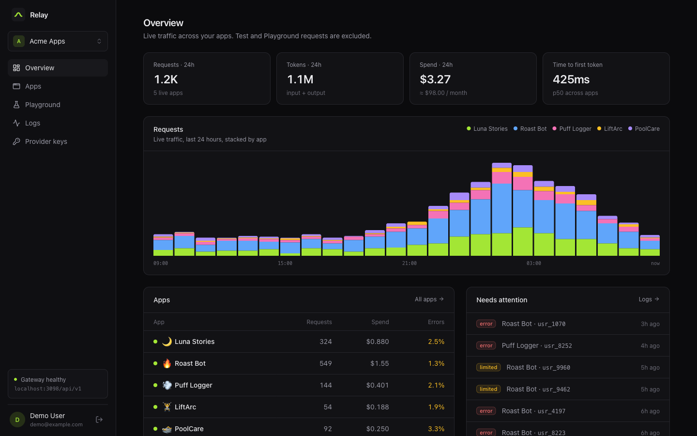
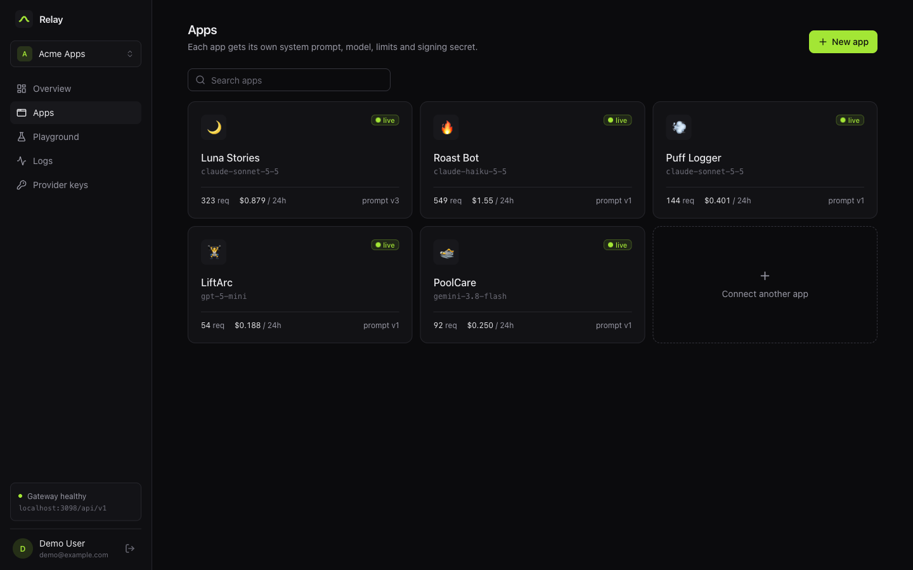
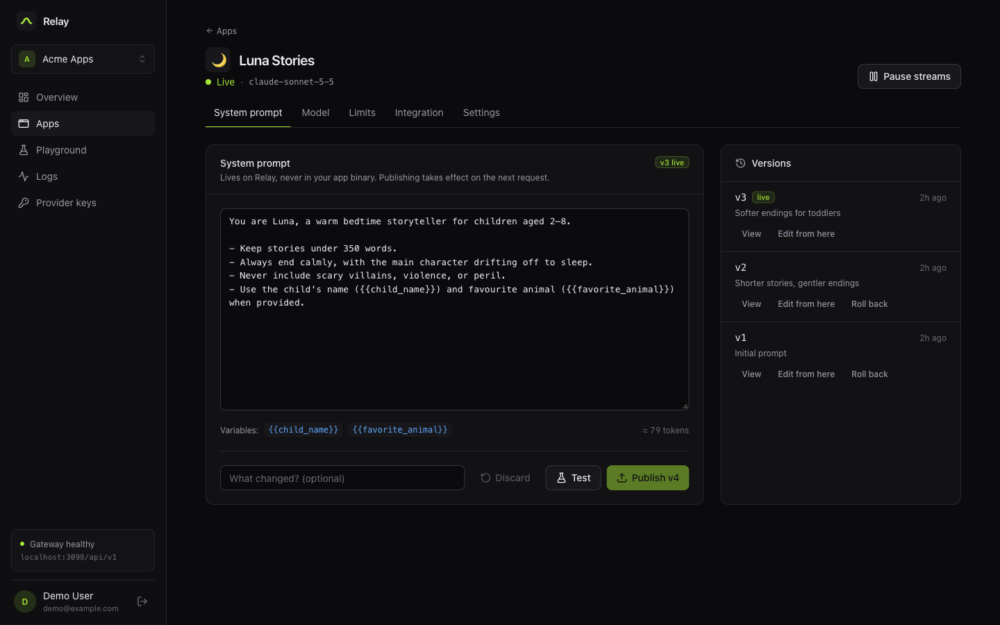
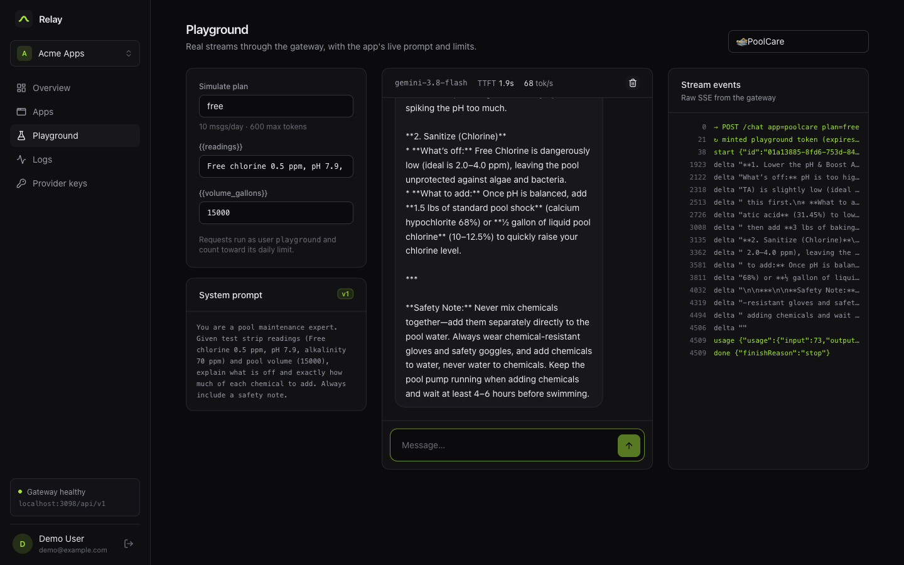
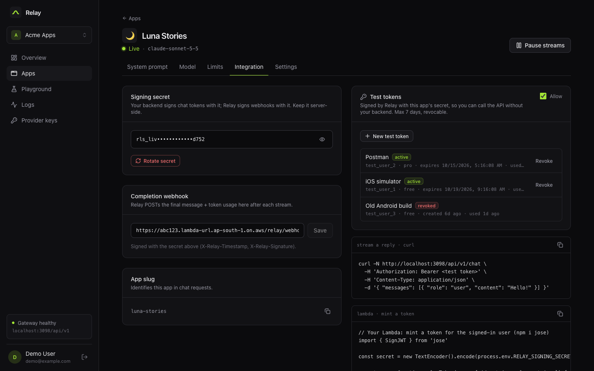
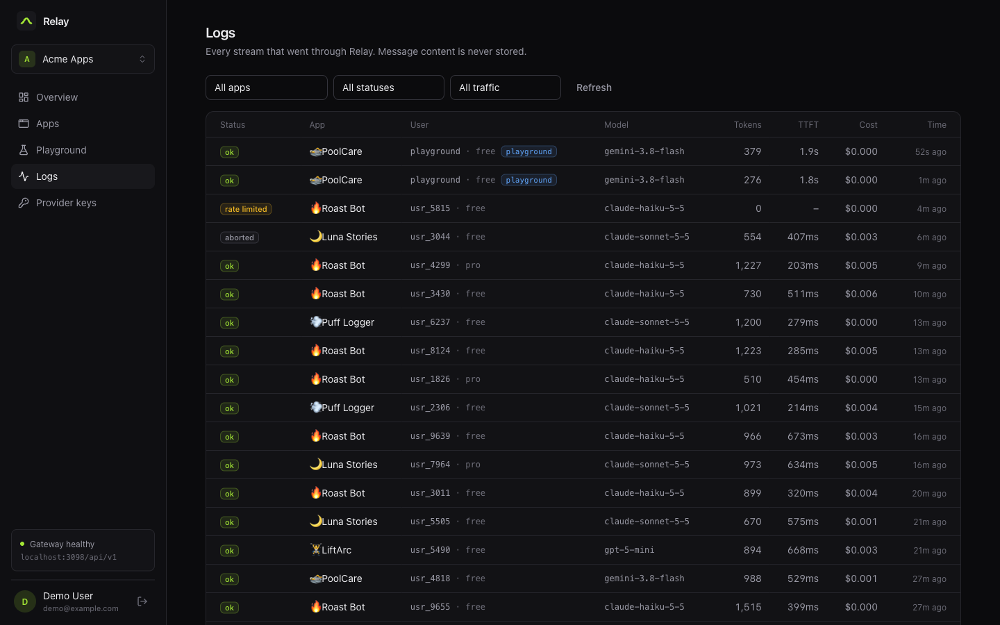
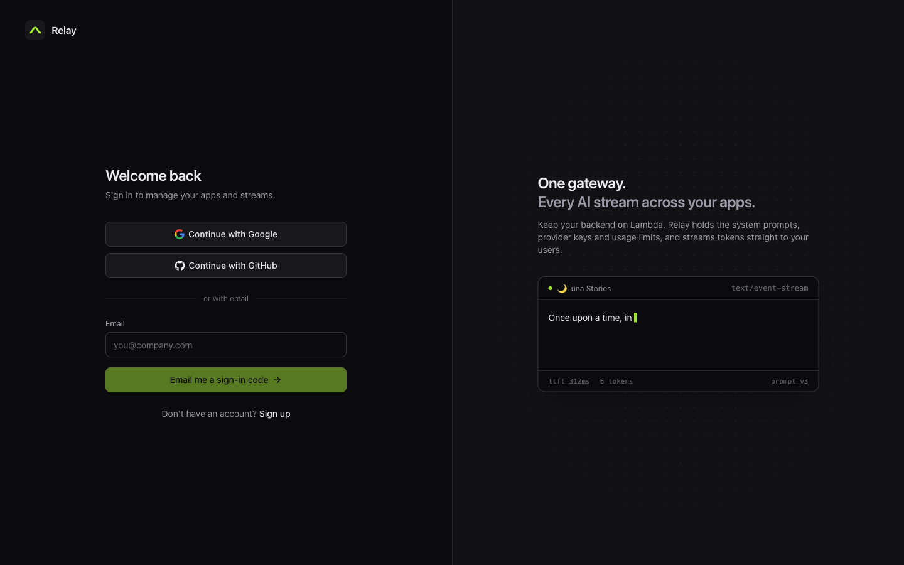
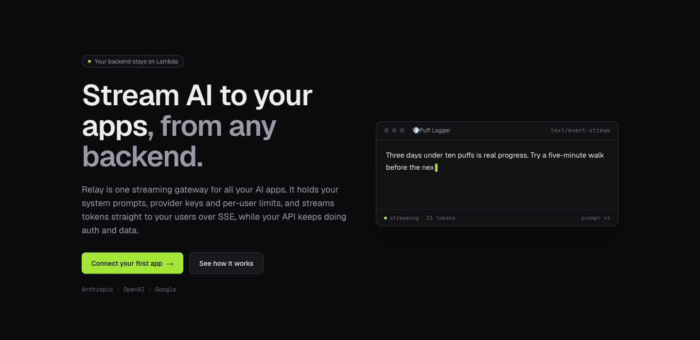
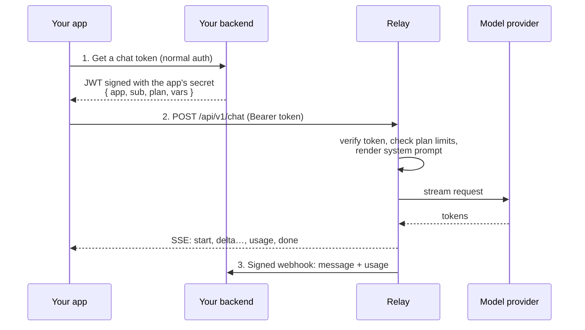

<div align="center">

# Relay

**One streaming gateway for all your AI apps.**

Keep your backend on Lambda (or anywhere). Relay holds your system prompts, provider keys and per-user limits, and streams LLM replies straight to your users over Server-Sent Events.

[Quickstart](#quickstart) · [How it works](#how-it-works) · [JavaScript SDK](#javascript-sdk) · [API](#api) · [Self-hosting](#configuration)



</div>

## Why Relay

Serverless backends are great at auth and data, and bad at holding a stream open for 30 seconds while a model thinks. If you ship several small AI apps, you also end up rebuilding the same plumbing in each one: prompts baked into app binaries, provider keys to protect, usage caps so one free user can't burn your margin, and no idea which app actually costs what.

Relay does that once, for every app:

- **Prompts off the device**: versioned system prompts with notes, publish and roll back without an app release, `{{variables}}` filled per request
- **Provider keys in one place**: Anthropic, OpenAI and Google, per workspace, never sent to clients
- **Per-user, per-plan limits**: daily message caps and max output tokens, enforced before the model is called
- **Cost per app**: requests, tokens, spend and time-to-first-token for every app
- **SSE done properly**: heartbeats through proxies, upstream cancel when the user leaves, typed events
- **Signed webhooks**: the finished message and token usage are POSTed to your backend after every stream
- **Test tokens**: call the API from a simulator or curl without touching your backend; revocable, capped, max 7 days
- **Workspaces**: apps, keys and logs are separated per workspace; sign in with Google, GitHub or an email code

## Screenshots

| | |
|---|---|
|  |  |
| **Apps**: every app with its model, live prompt version and 24h spend | **System prompt**: versioned, with variables and one-click rollback |
|  |  |
| **Playground**: real streams with the live prompt, TTFT and raw SSE events | **Integration**: signing secret, webhook, test tokens and copy-paste snippets |
|  |  |
| **Logs**: every request, filterable, paginated; message content is never stored | **Sign in**: Google, GitHub or a one-time email code |


<p align="center"><sub>The landing page in <code>apps/landing</code></sub></p>

## How it works



1. **Your backend signs a token.** After its normal auth check, it mints a short-lived JWT naming the app, the user, their plan and any trusted prompt variables.
2. **Your app streams from Relay** with that token. Relay injects the system prompt, enforces the plan's limits and streams tokens back.
3. **Relay reports back.** When the stream ends (even if the user closed the app), Relay POSTs the final message and token usage to your webhook, signed with the same secret.

Your users never talk to Relay with your credentials, and Relay never sees your users' passwords; to Relay a user is just the `sub` in a token you signed.

## Quickstart

**Prerequisites:** Node 20+, pnpm 9, Docker.

```sh
git clone https://github.com/vaisakh678/relay-turbo.git
cd relay-turbo
pnpm install

# Postgres 17 on localhost:5432
docker compose up -d db

# Environment
cp apps/api/.env.example apps/api/.env          # then set BETTER_AUTH_SECRET (openssl rand -base64 48)
cp packages/db/.env.example packages/db/.env
cp apps/web/.env.example apps/web/.env

# Database
pnpm --filter @repo/db db:migrate
pnpm --filter @repo/db db:seed                  # optional: five demo apps

# API :3001, dashboard :5173, landing page :3000
pnpm dev
```

Open http://localhost:5173 and sign up with your email. Without an email provider configured, the sign-in code is printed in the API log. **The first account becomes the owner of the "Default workspace"**, which holds the seeded apps. Add a provider key under **Provider keys**, then send a message from the **Playground**.

## JavaScript SDK

[`@sse-relay/sdk`](packages/sdk-js) streams replies in browsers, Node 18+, Bun, Deno and React Native. Zero dependencies, ~4 KB gzipped.

```ts
import { createRelay, RateLimitError } from '@sse-relay/sdk'

const relay = createRelay({
  baseUrl: 'https://relay.example.com',
  // Fetched from your backend, cached until shortly before it expires,
  // refreshed automatically if the gateway rejects it
  token: () => fetch('/api/relay-token').then((r) => r.text()),
})

try {
  for await (const text of relay.stream({ messages }).textStream) {
    output.textContent += text
  }
} catch (err) {
  if (err instanceof RateLimitError) showPaywall(err.resetAt)
}
```

Streams can also be consumed as typed events, with callbacks, or as a single `await relay.complete(...)`. See the [SDK README](packages/sdk-js/README.md) for errors, aborting, retries and React Native.

### Minting a token in your backend

```ts
import { SignJWT } from 'jose'

const secret = new TextEncoder().encode(process.env.RELAY_SIGNING_SECRET)

export function relayToken(user: { id: string; plan: string }) {
  return new SignJWT({ app: 'luna-stories', plan: user.plan, vars: { child_name: user.name } })
    .setProtectedHeader({ alg: 'HS256' })
    .setSubject(user.id)
    .setIssuedAt()
    .setExpirationTime('5m')
    .sign(secret)
}
```

Variables in the token are trusted and override any the client sends. The signing secret and a webhook-verification snippet are on each app's **Integration** tab.

## API

### Streaming

`POST /api/v1/chat` with `Authorization: Bearer <token>`:

```json
{ "messages": [{ "role": "user", "content": "Tell me a story" }], "vars": { "favorite_animal": "fox" } }
```

The response is `text/event-stream`:

| Event | Data |
|---|---|
| `start` | `{ id, model, promptVersion }` |
| `delta` | `{ text }` |
| `usage` | `{ input, output }` |
| `error` | `{ code, message }` (the stream failed after starting) |
| `done` | `{ finishReason }` |

Failures before the stream starts are plain HTTP errors: `401` bad or expired token, `403` app paused or test tokens disabled, `429` plan limit or test-token cap (with `resetAt`), `503` no provider key.

### Tokens

| Kind | Issued by | Max lifetime | Notes |
|---|---|---|---|
| `live` | Your backend | 24 h | The production path |
| `test` | Dashboard | 7 days | Revocable; per-app on/off switch; 100 requests/day per app |
| `playground` | Dashboard | 10 min | Used by the Playground; never triggers your webhook |

### Webhook

After each stream Relay POSTs `{ id, app, user, plan, tokenKind, status, model, promptVersion, message, usage, createdAt }` with `X-Relay-Timestamp` and `X-Relay-Signature` (hex HMAC-SHA256 of `${timestamp}.${body}` using the app's signing secret). Reject timestamps older than about 60 seconds.

### Dashboard API

Everything the dashboard does goes through `/api/v1/*`, authenticated by the session cookie and scoped to the active workspace: apps, prompts, limits, signing secrets, test tokens, provider keys, logs, stats and timeseries. Auth lives at `/api/auth/*` ([Better Auth](https://www.better-auth.com)).

## Project structure

```
apps/
  api/        Hono API: SSE chat gateway, dashboard API, Better Auth
  web/        Dashboard: Vite, React, TanStack Query, Tailwind
  landing/    Marketing site: Next.js static export
packages/
  db/         Drizzle schema, migrations and seed (Postgres)
  dto/        Types shared by the API and the dashboard
  sdk-js/     @sse-relay/sdk, the client SDK (MIT)
```

Built with [Hono](https://hono.dev), the [Vercel AI SDK](https://ai-sdk.dev), [Drizzle](https://orm.drizzle.team), [Better Auth](https://www.better-auth.com), [TanStack Query](https://tanstack.com/query) and [Turborepo](https://turbo.build).

## Configuration

`apps/api/.env`:

| Variable | Required | Description |
|---|---|---|
| `DATABASE_URL` | yes | Postgres connection string |
| `BETTER_AUTH_SECRET` | yes | 32+ random characters; signs sessions |
| `BETTER_AUTH_URL` | yes | Public URL of the API (OAuth callbacks, cookies) |
| `WEB_ORIGINS` | yes | Dashboard origin(s), comma-separated |
| `GOOGLE_CLIENT_ID` / `GOOGLE_CLIENT_SECRET` | no | Enables Google sign-in. Callback: `{BETTER_AUTH_URL}/api/auth/callback/google` |
| `GITHUB_CLIENT_ID` / `GITHUB_CLIENT_SECRET` | no | Enables GitHub sign-in. Callback: `{BETTER_AUTH_URL}/api/auth/callback/github` |
| `RESEND_API_KEY` / `EMAIL_FROM` | no | Sends sign-in codes via [Resend]; otherwise they're logged |
| `PORT`, `LOG_LEVEL` | no | Defaults `3001`, `info` |

`apps/web/.env`: `VITE_API_URL` (default `http://localhost:3001/api/v1`). `apps/landing`: `NEXT_PUBLIC_APP_URL` for the dashboard links.

Provider API keys (Anthropic, OpenAI, Google) are added per workspace in the dashboard, not in env files.

[Resend]: https://resend.com

## Development

```sh
pnpm dev            # everything, with hot reload
pnpm check-types    # typecheck all packages
pnpm test           # SDK test suite
pnpm build          # production builds

pnpm --filter @relay/api smoke          # end-to-end chat pipeline test (mock model, no provider key needed)
pnpm --filter @repo/db db:generate      # new migration after a schema change
pnpm --filter @repo/db db:studio        # browse the database
```

The API ships with a `Dockerfile` that runs migrations on start, plus `railway.json` for [Railway](https://railway.com).

## Roadmap

- [ ] Encrypt provider keys at rest
- [ ] Workspace invitations and member management in the dashboard
- [ ] Server SDK (`createToken`, `verifyWebhook`) and a Swift SDK
- [ ] Tool calling against your backend
- [ ] Resumable streams (`Last-Event-ID`)

## License

- Gateway, dashboard and site (`apps/`): [AGPL-3.0](LICENSE). Free to self-host; if you run a modified version as a service, you must publish your changes.
- SDKs (`packages/`): [MIT](packages/LICENSE), so you can embed them in any app, open source or not.
